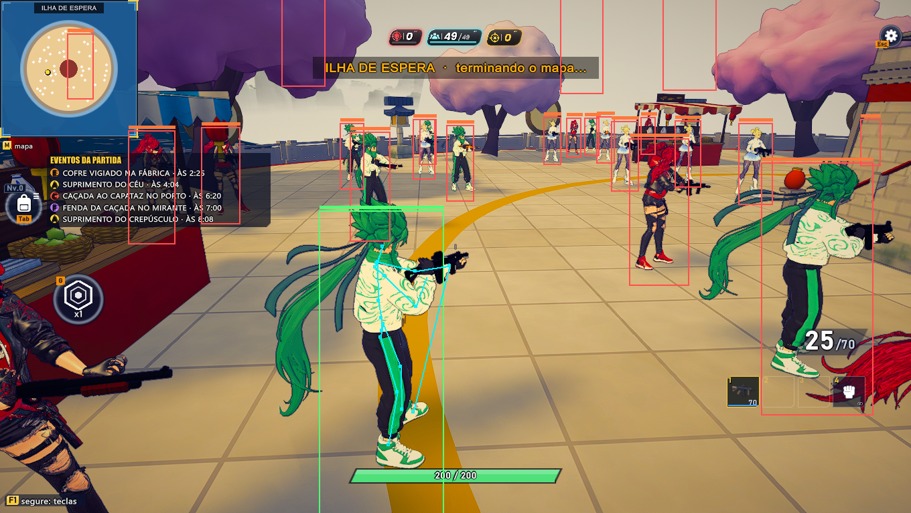

# Super Hero Royale — dump + loader/ESP (projeto educacional)

Laboratório de engenharia reversa e estudo de memória de um jogo Unity **Mono**: dump de metadata, resolvedor de ponteiros, CLI externa e um overlay ESP com menu.

> **Aviso de escopo:** projeto **educacional**, feito para testes **locais** no build `alfa-0.1-19` (build 19), que roda **offline contra bots**. Não envolve servidor, outros jogadores, contas, pagamentos nem dados pessoais. Não use em versões online nem em máquinas de terceiros. Respeite os termos de uso do jogo.



## O que este projeto NÃO faz

- Não usa hooks, patches de código, `WriteProcessMemory` em código, nem suspensão de threads.
- Não burla, desativa ou esconde nada de anti-cheat. Não há código de evasão.
- A DLL é carregada na própria sessão do jogo apenas com `LoadLibraryW` (injeção local para teste).
- **Únicas escritas em memória:** dois `float` do jogador local (HP e combustível). Todo o resto é somente leitura.

## Estrutura

| Pasta | Conteúdo |
|---|---|
| `dump/` | `offsets_dump.txt` (~10 MB, metadata completa da versão), saídas das sondas e ponteiros resolvidos |
| `src/` | Código-fonte: `shr_esp.cpp` (overlay), `shr_tool.cpp` (CLI), `shr_dump.cpp`, `shr_live.cpp` e sondas |
| `bin/` | Binários finais: `shr_tool.exe`, `shr_live.dll`, `shr_esp6.dll` (validada em partida) e `shr_esp7.dll` (scan de heap dinâmico) |
| `docs/` | `DUMP.md`, `ESP.md`, `ANTICHEAT.md`, `RESULTADOS.md` (relatório completo da investigação) |

## Compilando

Requer Visual Studio com as ferramentas de build C++ (testado com VS 18 Community). Para compilar **todos** os binários, sondas, explicação de cada flag e solução de problemas, veja [docs/PROGRAMACAO.md](docs/PROGRAMACAO.md). Comando mínimo do overlay:

```bat
call "C:\Program Files\Microsoft Visual Studio\18\Community\VC\Auxiliary\Build\vcvars64.bat"
cd /d C:\Users\Melinsky\Desktop\HerroDll\shr_tools\publish\src

cl /nologo /std:c++17 /EHsc /O2 /W4 /permissive- /LD shr_esp.cpp /Fe:shr_esp7.dll /link user32.lib gdi32.lib
cl /nologo /std:c++17 /EHsc /O2 /W4 /permissive- shr_tool.cpp /Fe:shr_tool.exe
```

## Usando

Descubra o PID **atual** (ele muda a cada inicialização — nunca reutilize um PID antigo):

```text
pid
```

Injete a DLL dentro da partida:

```text
inject <PID> bin\shr_esp7.dll
```

Ao entrar na partida, alvos, caixas e esqueletos aparecem automaticamente. O jogo continua `Responding = True`; a janela do overlay é transparente e não recebe cliques.

## Controles

Todos os recursos **começam ligados**; a tecla alterna o estado.

| Tecla | Função |
|---|---|
| `F1` | ESP on/off |
| `F2` | Caixa (vermelho = inimigo, verde = jogador) |
| `F3` | Esqueleto (vermelho = inimigo, ciano = jogador local) |
| `F4` | Barra de HP |
| `F5` | Nome |
| `F6` | Menu de texto |
| `F7` | HP infinito |
| `F8` | Combustível infinito |
| `F9` | Religar tudo de uma vez |

Estado em tempo real:

```text
C:\Users\Melinsky\AppData\Local\SuperHeroRoyale\jogo\.shr-versao-rVkyRE\esp_status.txt
```

## Documentação

- [PROGRAMACAO.md](docs/PROGRAMACAO.md) — **guia completo**: pré-requisitos, comandos de compilação de todos os binários, referência da CLI, arquitetura do código, como estender e portar para outra versão, solução de problemas.
- [DUMP.md](docs/DUMP.md) — como o dump foi feito, âncora do Mono, classes, offsets e cadeias de ponteiro.
- [ESP.md](docs/ESP.md) — arquitetura do overlay, desenho GDI, esqueleto e escritas pontuais.
- [ANTICHEAT.md](docs/ANTICHEAT.md) — como um anti-cheat detectaria este tipo de projeto, ideias de melhoria defensiva e notas educacionais sobre ofuscação.
- [RESULTADOS.md](src/RESULTADOS.md) — relatório cronológico com todas as descobertas e testes ao vivo.

## Limitações conhecidas

- Endereços absolutos valem **somente para a sessão em que foram lidos**. Use sempre a cadeia simbólica + offsets.
- `shr_esp7.dll` varre todas as regiões privadas `PAGE_READWRITE` para encontrar `BotAnimator`; isso é mais robusto entre sessões, mas mais caro que a faixa fixa usada em `shr_esp6.dll`.
- A classe da janela é única por DLL (`SHR_ESP_OVERLAY_<endereço_do_módulo>`). Isso evita que um `WndProc` de uma DLL antiga continue desenhando depois de reinjetar.
- Overlay é GDI (`~30 FPS`); não há aceleração nem hooks de renderização.
- Binários podem ser sinalizados por antivírus por heuristicamente envolverem injeção/overlay. Prefira compilar o fonte.

Sem garantias. Finalidade exclusiva de estudo de engenharia reversa em ambiente local.
